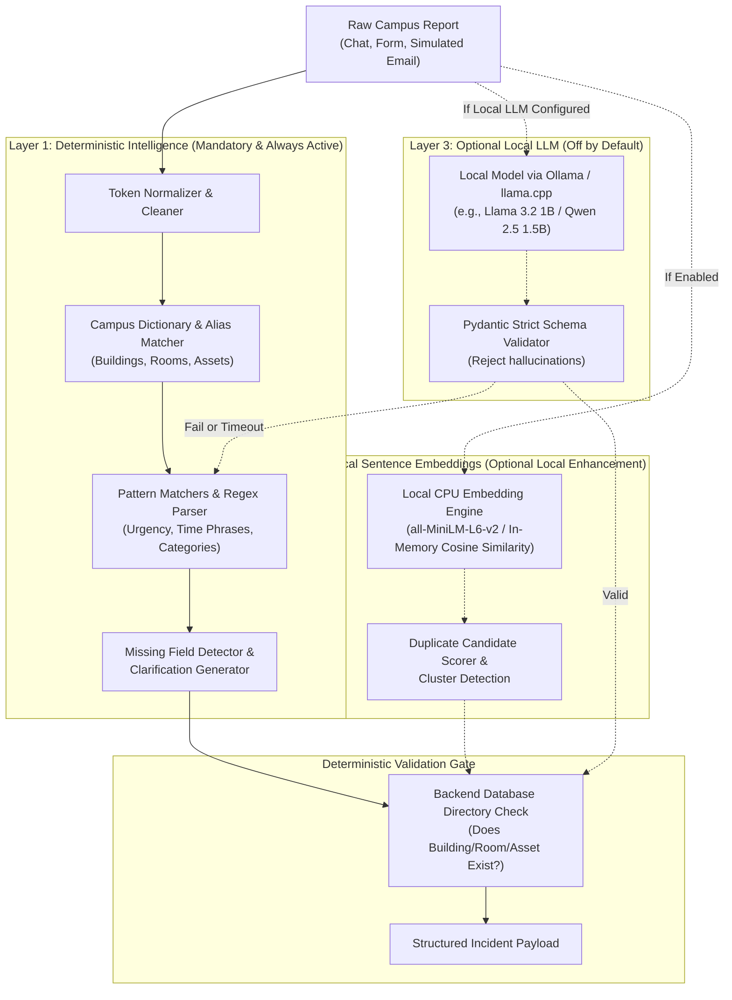

# CAMPUSOPS — FREE & OFFLINE AI ARCHITECTURE SPECIFICATION

In compliance with the Zero-Cost and Offline mandates, CampusOps implements a layered AI architecture that functions autonomously without cloud APIs, paid tokens, or internet connectivity.

---

## 1. Architectural Philosophy
> **"AI understands. The backend validates. Deterministic workflows execute. Humans approve sensitive actions."**

---

## 2. Layer 1: Deterministic Intelligence (Mandatory)

### 2.1 Keyword & Regex Extractor
- Runs 100% locally with zero machine-learning dependencies.
- **Category Pattern Rules:**
  - *Electrical:* `(spark|shock|power|blackout|breaker|socket|switch|wire|voltage|lights out)`
  - *HVAC / Air Conditioning:* `(ac|a/c|cooling|heating|ventilation|filter|leak|temperature|hot|freezing)`
  - *IT & AV Equipment:* `(projector|hdmi|display|audio|mic|screen|speaker|wifi|router|lan|cable)`
  - *Plumbing:* `(leak|pipe|water|clog|drain|faucet|toilet|flush|overflow)`
  - *Structural / Safety:* `(door|lock|window|glass|crack|ceiling|tile|elevator|stairs)`

### 2.2 Campus Dictionary & Alias Matching
- Dynamically loads known entity codes and aliases from the `buildings`, `rooms`, and `assets` tables:
  - `"Tech Park"`, `"TP"`, `"TP Block"`, `"Academic Block"` -> `BLD-TECH-01`
  - `"B204"`, `"TP 204"`, `"Room 204"` -> `RM-TP-204`
  - `"Epson Projector"`, `"Projector"` -> `AST-PROJ-001`
- Prevents silent hallucination: if a location is not in the database, it flags it as unverified.

### 2.3 Time Parsing & Urgency Evaluation
- Parses explicit relative time constraints:
  - `"in 20 minutes"`, `"starts at 10 AM"`, `"before exam"`, `"lecture in 15 mins"`
- Assigns priority dynamically:
  - Immediate academic disruption (< 60 mins before class/exam) -> **High / Critical**
  - Safety hazard (fire, spark, flooding) -> **Critical**
  - Minor cosmetic / non-blocking defect -> **Low / Medium**

### 2.4 Clarification Generator
- When essential attributes are missing (e.g. user says *"The AC is broken and making noise"* without specifying which room):
  - Automatically identifies missing fields: `location.room`
  - Prompts: *"Could you specify which room or floor in the building this is occurring in?"*

---

## 3. Layer 2: Local Sentence Embeddings (Optional)
- **Model:** Open-source `all-MiniLM-L6-v2` (Apache-2.0).
- **Execution:** CPU inference via in-memory cosine similarity or `pgvector`.
- **Use Case:** Recommends potential duplicate tickets and correlated historical failures across nearby rooms.
- **Safety Gate:** Similarity recommendations **never** automatically merge tickets. Merging requires explicit human confirmation.

---

## 4. Layer 3: Optional Local LLM (Disabled by Default)
- **Engine:** Local Ollama daemon running on `localhost:11434`.
- **Schema Validation:** Raw LLM outputs are fed through a strict Pydantic model (`IncidentExtractionSchema`).
- **Resilient Fallback:** If the local LLM is unresponsive, times out (> 3 seconds), or outputs invalid JSON, the system transparently falls back to Layer 1 deterministic extraction without throwing user-facing errors.
- **Rule of Authority:** An LLM is never permitted to approve a purchase, override a double-booking constraint, or assign a technician.
