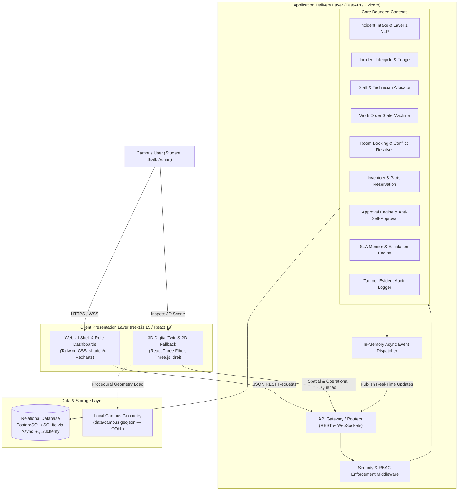

# CAMPUSOPS — SYSTEM ARCHITECTURE SPECIFICATION

In compliance with the ingested [`software-architecture`](file:///c:/Users/Dheena/Desktop/hackathon(SRM)/.agent/skills/software-architecture/SKILL.md) and [`c4-container`](file:///c:/Users/Dheena/Desktop/hackathon(SRM)/.agent/skills/c4-container/SKILL.md) directives, CampusOps is architected as a modular monolith adhering to Clean Architecture and Domain-Driven Design.

---

## 1. Architectural Style & Core Principles
- **Modular Monolith**: Single deployable unit with strictly enforced bounded contexts. Zero distributed network overhead between domain services.
- **Clean Architecture & Inversion of Control**: Domain entities and use cases are completely independent of HTTP frameworks (FastAPI) and storage mechanisms (SQLAlchemy/SQLite/Postgres).
- **Library-First & Anti-NIH**: Standard vetted libraries used for auth (`bcrypt`, `pyjwt`), validation (`pydantic`), and UI (`shadcn`, `tailwind`).
- **No Generic Dumping Grounds**: Anti-pattern directories such as `utils/`, `helpers/`, and `common/` are strictly banned. All modules are named according to their ubiquitous domain language.

---

## 2. C4 Container Diagram

---

## 3. Bounded Contexts & Responsibilities

| Bounded Context | Package Location | Primary Responsibilities |
| :--- | :--- | :--- |
| **Identity & Access** | `backend/app/domain/identity` | Password hashing, JWT creation/refresh, role-based access checks, permission validation. |
| **Campus Directory** | `backend/app/domain/campus` | Buildings, floors, rooms, departments, assets, equipment registry, spatial geo-linking. |
| **Incident Intake & AI**| `backend/app/domain/intake` | Multi-channel ingestion (form, chat, email), Layer 1 regex/dictionary NLP extraction. |
| **Incident Operations**| `backend/app/domain/incidents` | Status transitions, prioritization, grouping of related issues, history tracking. |
| **Work Orders** | `backend/app/domain/work_orders`| State machine (Created -> Assigned -> InProgress -> Verified -> Closed), parts demand. |
| **Staff & Allocation** | `backend/app/domain/staff` | Technician profiles, skills, shifts, availability, workload calculation, ranking. |
| **Resource Booking** | `backend/app/domain/bookings` | Space reservations, double-booking prevention, disruption impact analysis, relocations. |
| **Inventory & Parts** | `backend/app/domain/inventory` | Multi-item stock, atomic parts reservation, shortage alerts, movement logs. |
| **Procurement Approvals**| `backend/app/domain/approvals`| Multi-tier approvals, anti-self-approval rule, state re-validation prior to purchase. |
| **SLA & Escalation** | `backend/app/domain/sla` | Priority-based response/resolution timers, deadline warnings, automated escalation. |
| **Digital Twin** | `backend/app/domain/digital_twin`| Building status aggregation, GeoJSON coordinate normalization, HUD metrics. |
| **Audit & Events** | `backend/app/domain/audit` | Immutable audit log records, system events, event pub/sub. |

---

## 4. Concurrency & Transaction Strategy
- **Room Bookings**: Database constraints enforce non-overlapping time intervals per room. Concurrent booking transactions use database locking (`SELECT FOR UPDATE` or transaction rollback) to strictly prevent double-booking.
- **Inventory Reservation**: Atomic updates (`UPDATE inventory SET reserved = reserved + :qty WHERE quantity - reserved >= :qty`) guarantee stock cannot drop below zero, even under heavy concurrency.
- **Approval Re-validation**: When an approval is executed, the backend re-reads the underlying resource state (pricing, stock, availability) inside a fresh transaction. If stale, the execution is safely aborted.

---

## 5. Offline & Zero-Cost Architecture Guarantee
1. **Zero External Runtime APIs**: NLP extraction is performed in-process via Python regex, keyword tables, and the campus dictionary.
2. **Local Geometry**: Campus footprints are read directly from `data/campus.geojson`. No Mapbox, Google Maps, or Cesium ion.
3. **Local Fonts & Icons**: Lucide React SVG icons bundled locally. System and bundled sans-serif typography.
4. **Dual Database Engine**:
   - Primary Development: `sqlite+aiosqlite:///./data/campusops.db` (zero installation, zero cloud cost, 100% offline).
   - Enterprise/Docker: `postgresql+asyncpg://...` (standard PostgreSQL container).
   - Both utilize identical SQLAlchemy 2.0 async domain models and Alembic migrations.
