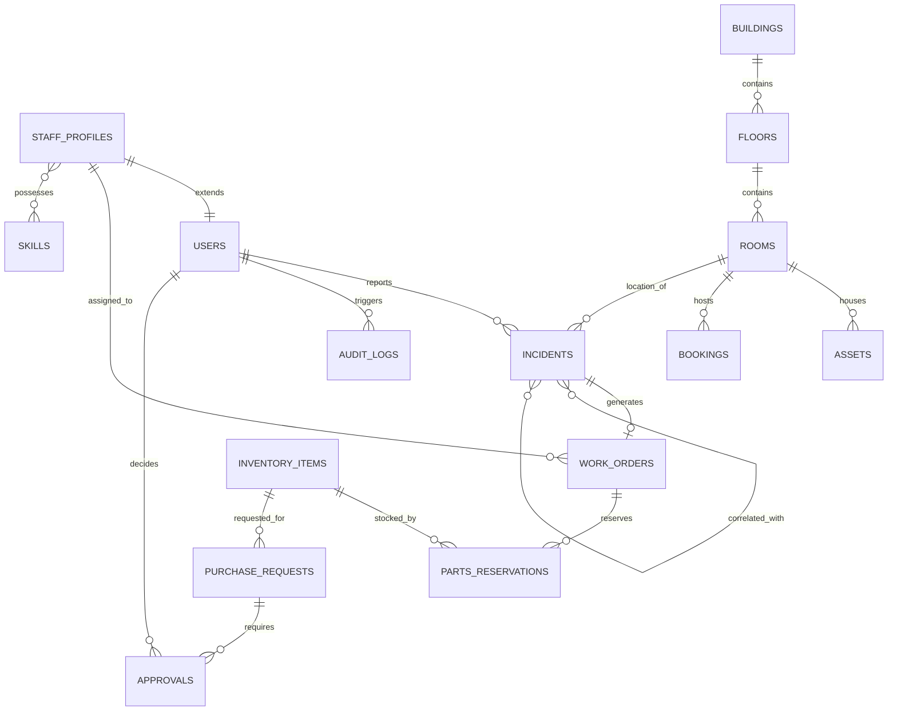

# CAMPUSOPS — DATABASE ARCHITECTURE & SCHEMA SPECIFICATION

In compliance with the ingested [`software-architecture`](file:///c:/Users/Dheena/Desktop/hackathon(SRM)/.agent/skills/software-architecture/SKILL.md) and [`postgresql`](file:///c:/Users/Dheena/Desktop/hackathon(SRM)/.agent/skills/postgresql/SKILL.md) directives, the CampusOps database enforces data integrity through foreign keys, check constraints, unique indexes, and ACID transaction boundaries.

---

## 1. Engine & Dialect Compatibility
- **Primary Async Driver (Local & Testing):** `aiosqlite` via SQLAlchemy 2.0 (zero external installation, zero cost, completely offline).
- **Production / Docker Driver:** `asyncpg` via SQLAlchemy 2.0 for PostgreSQL 16+.
- **Migration Engine:** Alembic for declarative schema versioning.

---

## 2. Entity-Relationship Overview

---

## 3. Core Table Specifications

### 3.1 `users`
- `id`: VARCHAR(36) PRIMARY KEY (UUID)
- `email`: VARCHAR(255) UNIQUE NOT NULL
- `hashed_password`: VARCHAR(255) NOT NULL
- `full_name`: VARCHAR(255) NOT NULL
- `role`: VARCHAR(50) NOT NULL (student, faculty, technician, dept_manager, facilities_admin, procurement_approver, system_admin)
- `department_id`: VARCHAR(36) NULL
- `is_active`: BOOLEAN DEFAULT TRUE NOT NULL
- `created_at`: TIMESTAMP WITH TIME ZONE DEFAULT CURRENT_TIMESTAMP NOT NULL

### 3.2 `buildings`
- `id`: VARCHAR(36) PRIMARY KEY (e.g. `BLD-TECH-01`)
- `name`: VARCHAR(255) NOT NULL
- `code`: VARCHAR(50) UNIQUE NOT NULL
- `building_type`: VARCHAR(50) NOT NULL (academic, administrative, laboratory, library, residential, auditorium)
- `floors_count`: INTEGER NOT NULL DEFAULT 1
- `height_meters`: FLOAT NOT NULL DEFAULT 15.0
- `operational_status`: VARCHAR(50) DEFAULT 'normal' NOT NULL (normal, active_incident, critical_incident, maintenance, restricted)
- `is_confirmed`: BOOLEAN DEFAULT TRUE NOT NULL

### 3.3 `rooms`
- `id`: VARCHAR(36) PRIMARY KEY (e.g. `RM-TP-204`)
- `building_id`: VARCHAR(36) REFERENCES `buildings(id)` ON DELETE CASCADE NOT NULL
- `room_number`: VARCHAR(50) NOT NULL
- `floor_number`: INTEGER NOT NULL
- `room_type`: VARCHAR(50) NOT NULL (lecture_hall, lab, seminar, office, conference)
- `capacity`: INTEGER NOT NULL DEFAULT 30
- `is_operational`: BOOLEAN DEFAULT TRUE NOT NULL
- UNIQUE (`building_id`, `room_number`)

### 3.4 `assets`
- `id`: VARCHAR(36) PRIMARY KEY (e.g. `AST-PROJ-001`)
- `room_id`: VARCHAR(36) REFERENCES `rooms(id)` ON DELETE SET NULL
- `asset_tag`: VARCHAR(100) UNIQUE NOT NULL
- `name`: VARCHAR(255) NOT NULL
- `category`: VARCHAR(50) NOT NULL (projector, hvac, electrical, furniture, network, lab_equipment)
- `status`: VARCHAR(50) DEFAULT 'operational' NOT NULL (operational, degraded, broken, retired)

### 3.5 `incidents`
- `id`: VARCHAR(36) PRIMARY KEY (UUID)
- `incident_number`: VARCHAR(50) UNIQUE NOT NULL (e.g. `INC-2026-0001`)
- `reporter_id`: VARCHAR(36) REFERENCES `users(id)` NOT NULL
- `title`: VARCHAR(255) NOT NULL
- `description`: TEXT NOT NULL
- `category`: VARCHAR(50) NOT NULL (electrical, hvac, plumbing, it_av, structural, safety)
- `priority`: VARCHAR(20) NOT NULL (low, medium, high, critical)
- `status`: VARCHAR(30) NOT NULL (reported, triage, assigned, in_progress, resolved, closed, cancelled)
- `building_id`: VARCHAR(36) REFERENCES `buildings(id)` NOT NULL
- `room_id`: VARCHAR(36) REFERENCES `rooms(id)` NULL
- `asset_id`: VARCHAR(36) REFERENCES `assets(id)` NULL
- `raw_text`: TEXT NULL
- `extraction_metadata`: JSON NOT NULL DEFAULT '{}'
- `created_at`: TIMESTAMP WITH TIME ZONE DEFAULT CURRENT_TIMESTAMP NOT NULL
- `resolved_at`: TIMESTAMP WITH TIME ZONE NULL

### 3.6 `work_orders`
- `id`: VARCHAR(36) PRIMARY KEY (UUID)
- `order_number`: VARCHAR(50) UNIQUE NOT NULL (e.g. `WO-2026-0001`)
- `incident_id`: VARCHAR(36) REFERENCES `incidents(id)` NOT NULL
- `assigned_technician_id`: VARCHAR(36) REFERENCES `users(id)` NULL
- `status`: VARCHAR(30) NOT NULL (pending, assigned, in_progress, awaiting_parts, pending_verification, completed)
- `priority`: VARCHAR(20) NOT NULL
- `estimated_duration_hours`: FLOAT DEFAULT 1.0 NOT NULL
- `resolution_notes`: TEXT NULL
- `created_at`: TIMESTAMP WITH TIME ZONE DEFAULT CURRENT_TIMESTAMP NOT NULL
- `updated_at`: TIMESTAMP WITH TIME ZONE DEFAULT CURRENT_TIMESTAMP NOT NULL

### 3.7 `bookings` (With Concurrency & Double-Booking Prevention)
- `id`: VARCHAR(36) PRIMARY KEY (UUID)
- `room_id`: VARCHAR(36) REFERENCES `rooms(id)` NOT NULL
- `booked_by_id`: VARCHAR(36) REFERENCES `users(id)` NOT NULL
- `title`: VARCHAR(255) NOT NULL
- `activity_type`: VARCHAR(50) NOT NULL (lecture, exam, seminar, meeting, lab_session)
- `start_time`: TIMESTAMP WITH TIME ZONE NOT NULL
- `end_time`: TIMESTAMP WITH TIME ZONE NOT NULL
- `attendee_count`: INTEGER NOT NULL DEFAULT 10
- `status`: VARCHAR(30) NOT NULL (confirmed, relocated, cancelled)
- `relocated_from_room_id`: VARCHAR(36) REFERENCES `rooms(id)` NULL
- INDEX (`room_id`, `start_time`, `end_time`)

### 3.8 `inventory_items` & `parts_reservations`
- `inventory_items`:
  - `id`: VARCHAR(36) PRIMARY KEY
  - `sku`: VARCHAR(100) UNIQUE NOT NULL
  - `name`: VARCHAR(255) NOT NULL
  - `category`: VARCHAR(50) NOT NULL
  - `quantity_on_hand`: INTEGER NOT NULL CHECK (quantity_on_hand >= 0)
  - `quantity_reserved`: INTEGER NOT NULL DEFAULT 0 CHECK (quantity_reserved >= 0)
  - `reorder_threshold`: INTEGER NOT NULL DEFAULT 5
  - `unit_cost`: FLOAT NOT NULL DEFAULT 0.0
- `parts_reservations`:
  - `id`: VARCHAR(36) PRIMARY KEY
  - `work_order_id`: VARCHAR(36) REFERENCES `work_orders(id)` NOT NULL
  - `item_id`: VARCHAR(36) REFERENCES `inventory_items(id)` NOT NULL
  - `quantity`: INTEGER NOT NULL CHECK (quantity > 0)
  - `status`: VARCHAR(30) NOT NULL (reserved, consumed, released)

### 3.9 `purchase_requests` & `approvals` (Anti-Self-Approval)
- `purchase_requests`:
  - `id`: VARCHAR(36) PRIMARY KEY
  - `item_id`: VARCHAR(36) REFERENCES `inventory_items(id)` NOT NULL
  - `requested_by_id`: VARCHAR(36) REFERENCES `users(id)` NOT NULL
  - `quantity`: INTEGER NOT NULL CHECK (quantity > 0)
  - `total_cost`: FLOAT NOT NULL
  - `justification`: TEXT NOT NULL
  - `status`: VARCHAR(30) NOT NULL (pending, approved, rejected, ordered, fulfilled)
- `approvals`:
  - `id`: VARCHAR(36) PRIMARY KEY
  - `purchase_request_id`: VARCHAR(36) REFERENCES `purchase_requests(id)` NOT NULL
  - `approver_id`: VARCHAR(36) REFERENCES `users(id)` NOT NULL
  - `decision`: VARCHAR(20) NOT NULL (approved, rejected)
  - `comments`: TEXT NOT NULL
  - `decided_at`: TIMESTAMP WITH TIME ZONE DEFAULT CURRENT_TIMESTAMP NOT NULL
  - **Constraint:** `CHECK (approver_id != requested_by_id)` enforced at service and database levels.

### 3.10 `audit_logs` & `operational_events`
- `id`: VARCHAR(36) PRIMARY KEY
- `event_type`: VARCHAR(100) NOT NULL
- `actor_id`: VARCHAR(36) REFERENCES `users(id)` NULL
- `entity_type`: VARCHAR(50) NOT NULL
- `entity_id`: VARCHAR(36) NOT NULL
- `before_state`: JSON NULL
- `after_state`: JSON NULL
- `ip_address`: VARCHAR(45) NULL
- `timestamp`: TIMESTAMP WITH TIME ZONE DEFAULT CURRENT_TIMESTAMP NOT NULL
- INDEX (`entity_type`, `entity_id`), INDEX (`timestamp`)
