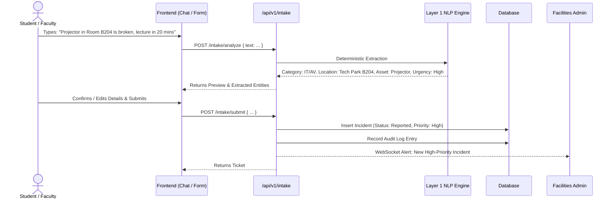
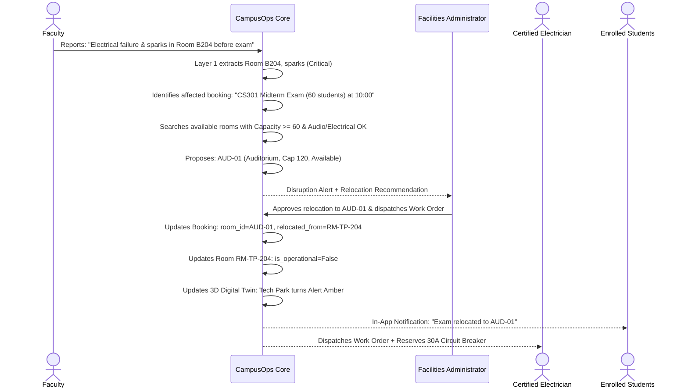
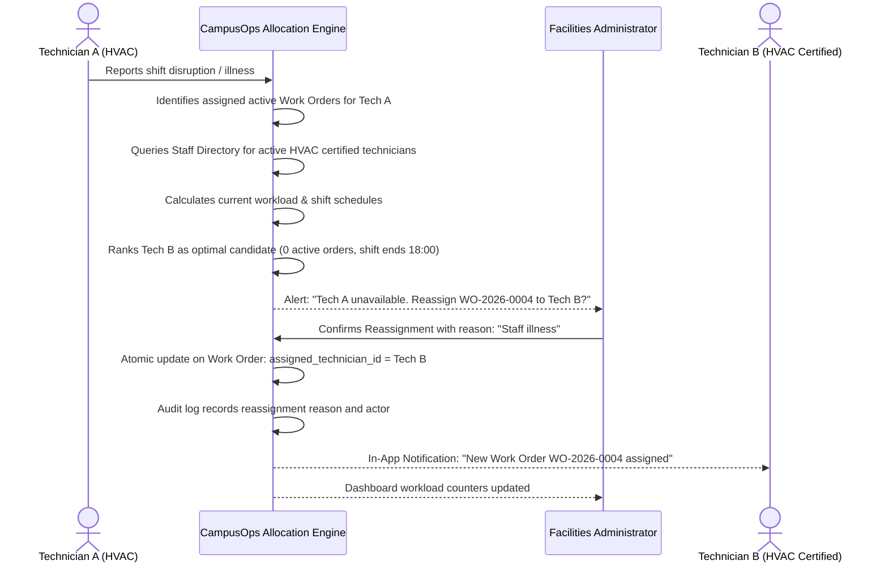
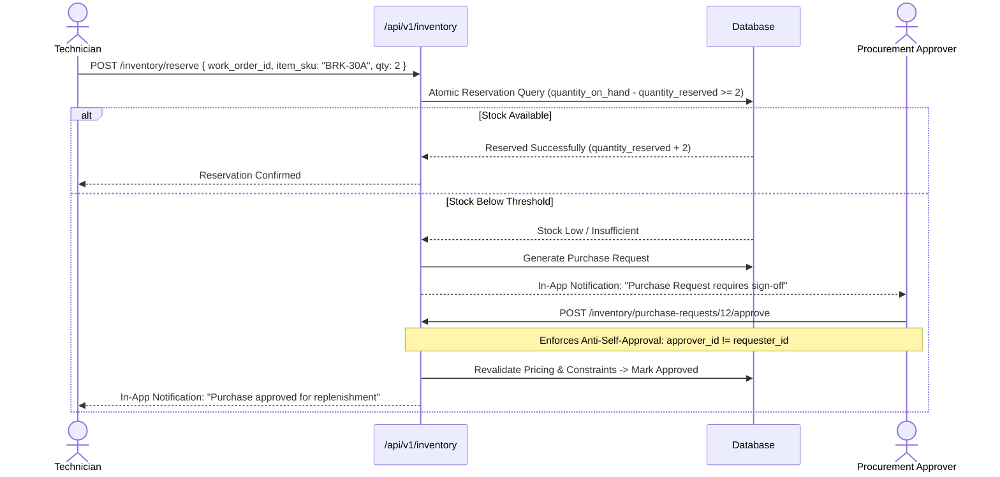

# CAMPUSOPS — USER FLOWS & JOURNEYS SPECIFICATION

This document details the operational user flows across all six personas, detailing UI steps, backend validations, and state transitions.

---

## 1. Flow 1: Natural-Language Incident Reporting & Triage (Student / Faculty)

---

## 2. Flow 2: Scenario A — Classroom Disruption & Re-allocation

---

## 3. Flow 3: Scenario B — Technician Unavailability & Dynamic Reassignment

---

## 4. Flow 4: Concurrency-Safe Inventory Reservation & Procurement Approval

